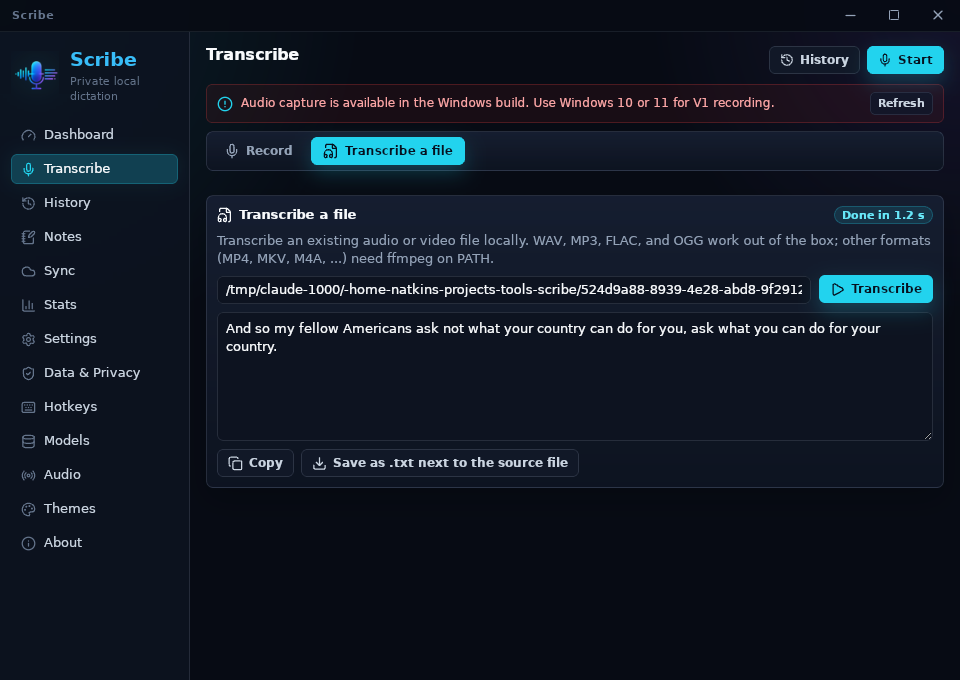

# Experimental Linux build: findings

Tested 2026-10-28 with the AppImage from the "Linux (experimental)" workflow run on PR #51 (`Scribe_0.9.0_amd64.AppImage`, 90 MB, plus a 12 MB `.deb`).
The test machine was WSL2 (Ubuntu 24.04) with WSLg for the display and PulseAudio, using a throwaway `HOME` so no real profile was touched.
The AppImage was run with `APPIMAGE_EXTRACT_AND_RUN=1` because WSL has no FUSE.
The `.deb` was not installed because that needs `sudo`; CI checks that it holds both whisper.cpp binaries under `bin/linux/`.
The UI was driven with synthetic X11 clicks (XTest) and captured window by window.

## What works

- The app starts in about two seconds and the main window renders the full UI (sidebar, Dashboard, every view).
- It runs under both the default Wayland backend and `GDK_BACKEND=x11`.
- WebKitGTK cannot use the GPU under WSLg (`libEGL`/`ZINK` warnings) and falls back to software rendering without visible problems.
- The settings database, logs and models live under `~/.local/share/com.natkins.scribe`, and the dictation-state server writes `~/.scribe/control.json` as on Windows.
- Model download works: Tiny English (75 MiB) downloaded from Hugging Face, passed the SHA-256 check and could be selected as the active model.
- File transcription works end to end with the bundled, statically linked whisper.cpp: `jfk.wav` (11 s) became "And so my fellow Americans ask not what your country can do for you, ask what you can do for your country." in 1.2 s on the Tiny model, CPU only.
- "Save as .txt next to the source file" wrote `jfk.wav.txt`, and "Copy" reported success.
- Settings, History, Sync, Audio, Models, About and their controls render and respond.
- Global hotkeys with modifiers work through X11: Ctrl+Alt+F brought the window up on the Dashboard.
- The About update check runs against the stable feed and reports "You're on the latest version."

## What does not work

- Recording does not work at all: audio capture (`cpal`) is compiled for Windows only, so Start shows "Audio capture is available in the Windows build" and the microphone list is empty.
  Live dictation, notes, the level test and auto-stop all depend on it.
- The Hold-to-Talk default (Ctrl+Win) cannot be registered, because modifier-only shortcuts are Windows-only; the Dashboard marks it with a warning.
- The default Toggle Dictation key, a bare backtick, is grabbed globally on X11, so typing a backtick in any other X11 app goes to Scribe instead (it then fails with the recording error).
  A Linux build would need a different default.
- Paste into other apps, Direct Insert (typing the text) and clipboard restore are stubs outside Windows (`output.rs` returns "implemented for Windows only"); only the copy-to-clipboard paths exist.
- The GitHub token store uses the `keyring` crate with only its Windows backend enabled, so on Linux the token would not survive a restart (from the code; GitHub sign-in was not tried).
- GPU acceleration is off: the Linux whisper.cpp build is CPU only, and the GPU probe is Windows-only.
- Updates cannot reach Linux: the published `latest.json` has only a `windows-x86_64` entry and the Linux bundles carry no updater artifacts, so a newer stable release would make the check fail instead of offering an update.
- No tray icon was visible under WSLg, which has no system tray, so closing to the tray could not be checked.
- Global hotkeys are X11 grabs, so on a native Wayland desktop they only fire while an X11 window has focus.
- Copy written in the UI still speaks of Windows (for example "Use Windows 10 or 11", "Windows clipboard history", "Scribe is a Windows tray utility").

## What a usable Linux release would need

1. Audio capture on Linux (`cpal` with ALSA/PulseAudio, or PipeWire), which unlocks dictation.
2. Paste and type support (`xdotool`/`wtype`, or the XDG RemoteDesktop portal on Wayland) and clipboard save and restore.
3. Linux-safe default hotkeys and a Wayland global-shortcut path (the XDG GlobalShortcuts portal).
4. The `keyring` Secret Service backend for the GitHub token.
5. A `linux-x86_64` entry in `latest.json` with a signed AppImage, if Linux builds should update themselves.
6. Platform-neutral wording in the UI.
